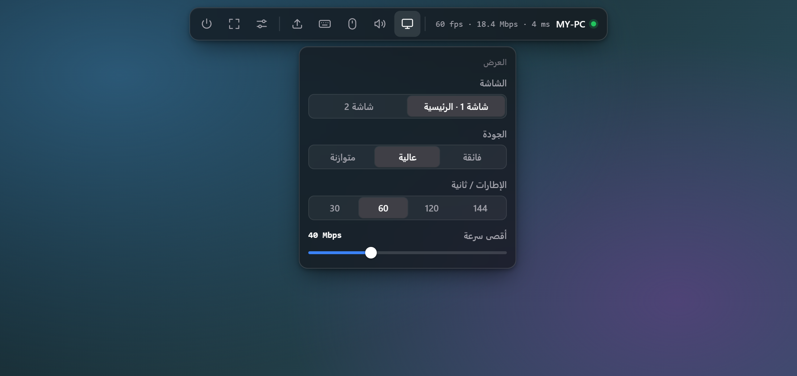
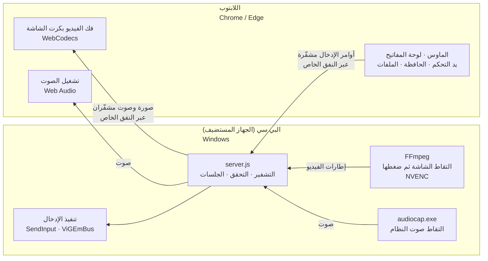
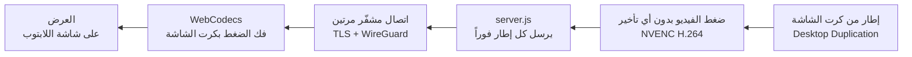
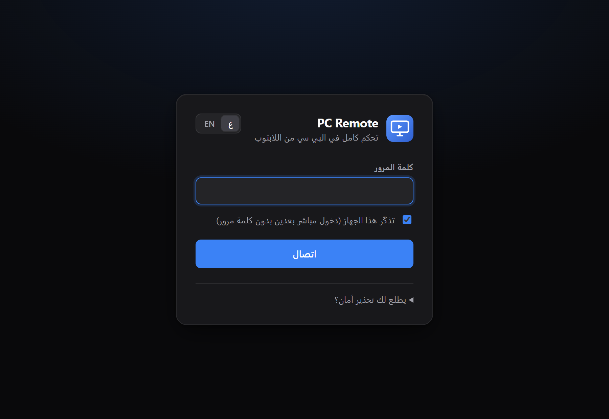
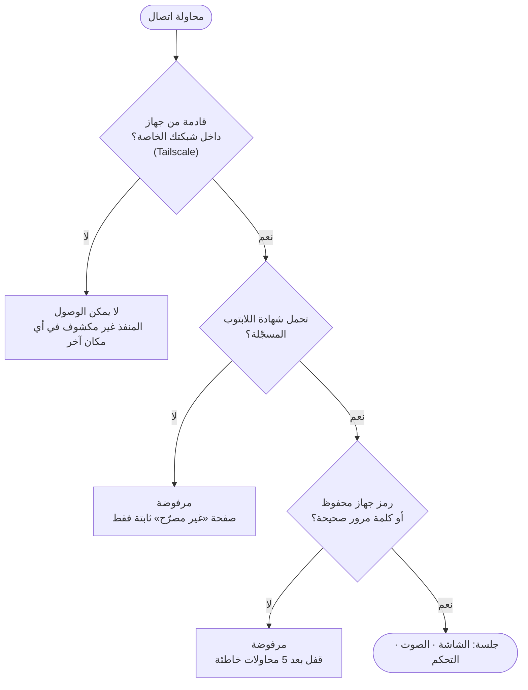

<div dir="rtl">

<p align="center">
  
</p>

<h1 align="center">PC Remote</h1>

<p align="center">
  <b>سطح مكتب بعيد خاص وسريع الاستجابة لجهازك الشخصي على ويندوز.</b><br>
  تحكّم فيه من متصفح اللابتوب ومن أي شبكة، ولا يدخله إلا لابتوبك <i>أنت</i>.
</p>

<p align="center">
  <a href="README.md"><b>English</b></a> ·
  <a href="#التثبيت">التثبيت</a> ·
  <a href="#كيف-تعمل-الأداة">كيف تعمل</a> ·
  <a href="#الأمان-باختصار">الأمان</a> ·
  <a href="#أسئلة-شائعة">أسئلة شائعة</a>
</p>

<p align="center">
  
  
  
  
</p>

<p align="center">
  
</p>

---

## لماذا PC Remote

- **كأنك أمام الجهاز.** تُلتقط الشاشة وتُضغط بكرت الشاشة، ويفك اللابتوب الفيديو بكرت شاشته، وتُرسل كل صورة لحظة جاهزيتها. لا إعادة ضغط ولا مرور عبر خوادم أي شركة.
- **لك وحدك.** ثلاثة أقفال مستقلة: شبكة خاصة، وشهادة جهاز لا يملكها إلا لابتوبك، وكلمة مرور. الغريب يفشل عند القفل الأول، ومن يعرف كلمة مرورك يفشل عند القفل الثاني.
- **بدون نافذة «هل تقبل الاتصال؟».** الجهاز جهازك، فيتصل مباشرة. ولهذا السبب بالذات يجب ألا تُثبّت الأداة إلا على أجهزة تملكها.
- **لا شيء يُثبّت على اللابتوب** غير Tailscale وشهادة. التطبيق يعمل داخل Chrome أو Edge، ويمكن تثبيته كتطبيق بنافذة مستقلة.

## المزايا

| | |
|---|---|
| **الصورة** | حتى 144 إطاراً في الثانية · ثلاث درجات جودة · حد للسرعة من 5 إلى 120 ميجابت · تخفيض تلقائي إذا لم تلحق الشبكة |
| **الشاشات** | التنقل بين أكثر من شاشة · تحجيم واضح لأي دقة في اللابتوب |
| **لوحة المفاتيح** | كل المفاتيح، ومنها Win و Alt+Tab و Esc في وضع ملء الشاشة · الكتابة تتبع لغة لوحة المفاتيح في البي سي (عربي، إنجليزي…) |
| **الماوس** | مؤشر دقيق · **وضع الألعاب** بقفل الماوس وحركة نسبية خام |
| **الصوت** | صوت البي سي يُسمع في اللابتوب |
| **يد التحكم** *(تجريبي)* | يد ألعاب موصولة باللابتوب تظهر في البي سي كيد Xbox 360، مع الاهتزاز |
| **الحافظة** | النص المنسوخ في أي جهاز يصبح متاحاً في الآخر |
| **الملفات** | اسحب الملفات وأفلتها على الشاشة لإرسالها للبي سي (`Downloads\PCRemote`) |
| **الفلاش** *(تجريبي)* | فلاش موصول باللابتوب يُفتح في البي سي كقرص `U:` |
| **الواجهة** | شريط أدوات عائم يختفي تلقائياً · عربي وإنجليزي · مظهر داكن أو فاتح أو تلقائي · ألوان تمييز |
| **يعمل دائماً** | يبدأ مع تسجيل الدخول لويندوز، ويعيد تشغيل نفسه إذا تعطل، ويبقي البي سي مستيقظاً أثناء اتصالك |

---

## كيف تعمل الأداة

<div dir="ltr">



</div>

1. **الالتقاط.** يستخدم `ddagrab` في FFmpeg واجهة Desktop Duplication في ويندوز لأخذ كل إطار مباشرة من كرت الشاشة، فلا يتعب المعالج تقريباً.
2. **الضغط.** يضغط معالج الفيديو المخصص في كرت الشاشة (NVENC) كل إطار بصيغة H.264 في وضع «بدون تأخير» وبدون إطارات B، فلا ينتظر إطار إطاراً آخر. ولا يُنشأ إطار مفتاحي جديد إلا عند الحاجة.
3. **الإرسال.** يقرأ `server.js` مخرجات FFmpeg ويرسل كل إطار لحظة خروجه عبر WebSocket مع إلغاء تأخير Nagle.
4. **الحماية.** اتصال WebSocket مشفّر بـ TLS ويمر داخل نفق WireGuard الخاص بـ Tailscale، ولا يُسمح بالدخول إلا للابتوب الذي يحمل الشهادة المسجّلة.
5. **فك الضغط والعرض.** يفك المتصفح الفيديو بكرت شاشة اللابتوب (WebCodecs) ويرسمه على الشاشة. وإذا تأخر فك الضغط، يقفز للإطار المفتاحي التالي بدل أن يتراكم التأخير.
6. **التحكم.** ترجع أوامر الماوس ولوحة المفاتيح ويد التحكم كرسائل صغيرة جداً، وتُنفّذ عبر `SendInput` في ويندوز أو تعريف ViGEmBus.
7. **التكيّف.** إذا لم تلحق الشبكة، يوقف البي سي البث مؤقتاً حتى يفرغ الطابور، ثم يكمل بـ 70% من السرعة السابقة وبإطار مفتاحي جديد. ترى تنبيهاً قصيراً بدل تأخير يكبر.

مسار الصورة خطوة بخطوة:

<div dir="ltr">



</div>

والصوت بنفس الفكرة: يُلتقط صوت البي سي (WASAPI loopback) ويُرسل على قطع مدة كل منها 20 جزءاً من الألف من الثانية. يشغّلها اللابتوب متتالية، وأي قطعة تصل متأخرة تُحذف بدل أن تنتظر، فلا يتأخر الصوت عن الصورة أبداً.

---

## المتطلبات

| | البي سي (الجهاز الذي تتحكم فيه) | اللابتوب (الجهاز الذي تستخدمه) |
|---|---|---|
| **النظام** | ويندوز 10 أو 11، نسخة 64 بت | ويندوز 10 أو 11 (مُفضّل)<sup>1</sup> |
| **العتاد** | كرت شاشة NVIDIA يدعم NVENC (سلسلة GeForce GTX 900 أو أحدث، وأي كرت RTX) مع تعريف محدّث | أي لابتوب يشغّل فيديو عالي الدقة |
| **البرامج** | تُثبّت تلقائياً: Node.js و FFmpeg و Tailscale (و ViGEmBus إن أردت يد التحكم) | Chrome أو Edge (آخر إصدار)، و Tailscale |
| **الحساب** | حساب [Tailscale](https://tailscale.com) مجاني، نفس الحساب على الجهازين | ← نفس الحساب |
| **الشبكة** | سرعة رفع من 10 إلى 40 ميجابت لدقة 1080p بـ 60 إطاراً (ويمكن خفضها حتى 5 ميجابت) | نفسها كسرعة تحميل |
| **الصلاحيات** | صلاحيات مدير لمرة التثبيت فقط | إذن تثبيت شهادة لحساب المستخدم |

<sup>1</sup> مثبّت الشهادة بضغطة واحدة سكربت خاص بويندوز. على macOS و Linux مع Chrome يُفترض أن تعمل الأداة إذا استوردت شهادة `.p12` يدوياً، لكن ذلك غير مُختبر.

كروت AMD و Intel غير مدعومة حالياً (الضغط يعتمد على NVENC فقط).

---

## التثبيت

### 1 · على البي سي

1. حمّل ملف ZIP لآخر إصدار من صفحة **Releases**، أو من **Code ← Download ZIP**.
2. قبل فك الضغط: اضغط على الملف بالزر الأيمن ← **Properties** ← فعّل **Unblock** ← OK. هذا يمنع تحذيرات ويندوز عن الملفات القادمة من الإنترنت.
3. فك الضغط في مجلد دائم، مثل `C:\PCRemote`. التشغيل التلقائي يعمل من هذا المجلد، فلا تتركه في Downloads.
4. اضغط مرتين على **`install.bat`** ووافق على نافذة صلاحيات المدير.

المثبّت يشرح كل خطوة أثناء التنفيذ، وهذا ما يفعله:

| الخطوة | ماذا يحدث |
|---|---|
| Node.js والحزم | يثبّت Node.js (نسخة LTS) عبر `winget` إذا لم يكن موجوداً، ثم الحزم بنفس الإصدارات المثبّتة في `package-lock.json` |
| FFmpeg | يحمّل النسخة الرسمية لويندوز (حوالي 110 ميجابايت) إلى مجلد `bin\` |
| يد التحكم *(اختياري)* | يسألك هل تريد تثبيت تعريف ViGEmBus. أجب `y` إذا تريد دعم يد الألعاب |
| كلمة المرور | يطلب منك اختيار كلمة مرور من 8 أحرف على الأقل. ستكتبها مرة واحدة على اللابتوب |
| Tailscale | يثبّت Tailscale ويفتح نافذة في المتصفح لتسجيل الدخول |
| العنوان الخاص | يضبط PC Remote ليستمع **فقط** على عنوان Tailscale الخاص بالبي سي |
| شهادة اللابتوب | ينشئ شهادة لابتوبك الشخصية في `data\enroll` |
| الجدار الناري | يسمح بالمنفذ 9443 **فقط** من عناوين Tailscale |
| التشغيل التلقائي | يسجّل مهمة مجدولة باسم **PCRemote** تبدأ مع تسجيل الدخول، ثم يشغّلها فوراً |

في النهاية يفتح مجلد `data\enroll` ويطبع عنوان البي سي، مثلاً `https://my-pc.tailxxxx.ts.net:9443`.

### 2 · على اللابتوب

1. ثبّت [Tailscale](https://tailscale.com/download) وسجّل الدخول **بنفس الحساب** الذي في البي سي.
2. انقل مجلد `enroll` من البي سي إلى اللابتوب بطريقة خاصة: فلاش، أو مشاركة الملفات في Tailscale (*Send with Tailscale*). لا ترسله بالإيميل ولا ترفعه على التخزين السحابي، لأنه يحتوي على مفتاح لابتوبك.
3. شغّل **`install-on-laptop.bat`** من داخل المجلد، ووافق إذا سألك ويندوز عن الوثوق بالشهادة.
4. **احذف مجلد `enroll`** من اللابتوب ومن البي سي بعد التثبيت.

### 3 · الاتصال

1. أغلق **كل** نوافذ Chrome/Edge ثم افتح المتصفح من جديد ليقرأ الشهادة.
2. ادخل على العنوان الذي طبعه المثبّت (`https://<اسم-البي-سي>.<شبكتك>.ts.net:9443`).
3. إذا سألك المتصفح أي شهادة تستخدم، اختر **PCRemote Laptop**.
4. اكتب كلمة المرور وأبقِ خيار **تذكّر هذا الجهاز** مفعّلاً. من الآن فصاعداً يتصل اللابتوب مباشرة.
5. اختياري: من قائمة المتصفح ← **Install as app** لتحصل على نافذة مستقلة وأيقونة على سطح المكتب.

<p align="center">
  
</p>

### التحديث

حمّل النسخة الجديدة وفك ضغطها فوق المجلد الحالي، **مع الإبقاء على مجلد `data\`** الذي يحتوي إعداداتك ومفاتيحك. ثم شغّل `install.bat` مرة أخرى. لابتوبك يظل يعمل بدون إعادة تثبيت شهادته.

### الإزالة

1. على البي سي: شغّل **`uninstall.bat`**. يوقف PC Remote ويحذف مهمة التشغيل التلقائي وقاعدة الجدار الناري. ثم احذف المجلد. يمكن إزالة Tailscale و ViGEmBus من *الإعدادات ← التطبيقات*.
2. على اللابتوب: افتح `certmgr.msc` واحذف **PCRemote Laptop** (*Personal ← Certificates*) و **PCRemote Local CA (…)** (*Trusted Root Certification Authorities ← Certificates*).

---

## الاستخدام

حرّك الماوس إلى **الحافة العلوية** للشاشة، أو اضغط **Ctrl + Alt + Shift + M**، ليظهر شريط الأدوات. يختفي من نفسه عندما تبتعد عنه، ولإبقائه ظاهراً فعّل *الإعدادات ← إبقاء الشريط ظاهر*.

| في الشريط | وظيفته |
|---|---|
| ● اسم الجهاز · fps · Mbps · ms | حالة الاتصال والسرعة والتأخير مباشرة |
| **العرض** | الشاشة، والجودة (فائقة / عالية / متوازنة)، والإطارات في الثانية (30 / 60 / 120 / 144)، وأقصى سرعة |
| **الصوت** | كتم الصوت أو تشغيله. تصبح الأيقونة حمراء عند الكتم |
| **الماوس** | إظهار مؤشر اللابتوب · **وضع الألعاب** (يقفل الماوس داخل الشاشة، وللخروج Ctrl+Alt+Shift+M) |
| **اختصارات** | Win · Alt+Tab · Alt+F4 · مدير المهام · سطح المكتب · مستكشف الملفات · لقطة شاشة · تبديل لغة لوحة المفاتيح |
| **إرسال ملف** | اختر ملفات لإرسالها، أو اسحبها على الشاشة. تصل إلى `Downloads\PCRemote` |
| **الإعدادات** | المظهر · لون التمييز · اللغة · إبقاء الشريط ظاهر · الإحصائيات · نسيان هذا الجهاز |
| **ملء الشاشة** | في ملء الشاشة تذهب Win و Alt+Tab و Esc وغيرها للبي سي. للخروج اضغط مطولاً على **Esc** |
| **قطع الاتصال** | ينهي الجلسة |

**نصائح**

- **الصوت** يبدأ بعد أول نقرة أو ضغطة زر في الصفحة، لأن المتصفحات تشترط تفاعلاً واحداً قبل تشغيل الصوت.
- **الكتابة** تتبع لغة لوحة المفاتيح في البي سي. بدّلها بـ Alt+Shift أو باختصار *تبديل لغة لوحة المفاتيح*.
- **الحافظة:** في أول مرة يطلب المتصفح إذن الوصول للحافظة. اختر Allow.
- **يد التحكم:** صِل اليد باللابتوب واضغط أي زر والصفحة نشطة. يظهر تنبيه يؤكد اتصالها.
- **أنعم صورة:** في البيت 60 إطاراً بجودة عالية و 40 ميجابت. وعلى بيانات الجوال جرّب 60 إطاراً بسرعة 10 إلى 15 ميجابت. أما 120 و 144 إطاراً فتحتاج اتصالاً قوياً.

### استخدام فلاش اللابتوب في البي سي *(تجريبي)*

تشارك هذه الطريقة فلاشاً موصولاً باللابتوب عبر Tailscale، فيُفتح في البي سي كقرص `U:`. تعمل للملفات فقط، والبرامج التي تحتاج جهاز USB حقيقياً (مفاتيح الترخيص، أو برامج حرق ويندوز على الفلاش) لن تراه.

على **اللابتوب**، في PowerShell بصلاحيات مدير: استبدل `E:` بحرف الفلاش، والعنوان بعنوان Tailscale الخاص بالبي سي (يظهر في تطبيق Tailscale):

<div dir="ltr">

```powershell
New-SmbShare -Name USB -Path 'E:\' -ChangeAccess "$env:USERDOMAIN\$env:USERNAME"
New-NetFirewallRule -DisplayName 'PC Remote USB share' -Direction Inbound -Action Allow -Protocol TCP -LocalPort 445 -RemoteAddress 100.x.y.z
```

</div>

يجب أن يكون لحساب ويندوز في اللابتوب كلمة مرور. ثم على **البي سي** شغّل **`connect-usb.bat`**، واكتب اسم اللابتوب في Tailscale، وسجّل الدخول باسم مستخدم اللابتوب وكلمة مروره.

### أمور يجب معرفتها

- **يجب أن يكون ويندوز مسجّل الدخول وغير مقفل.** ويندوز يمنع عمداً التقاط شاشة القفل ونافذة صلاحيات المدير المعتمة (UAC secure desktop). لا تقفل البي سي بـ Win+L إذا كنت ستستخدمه عن بُعد.
  - لاستخدام البي سي بعد إعادة التشغيل بدون أن تلمسه، يمكنك تفعيل تسجيل الدخول التلقائي (`netplwiz`). وهذا يعني أن أي شخص يصل للبي سي فعلياً يدخل أيضاً.
  - للموافقة على نوافذ صلاحيات المدير عن بُعد، اضبط UAC على *«Notify me… (do not dim my desktop)»*. هذا يزيل الشاشة المعتمة التي تحمي تلك النوافذ من التزييف، فيُضعف UAC قليلاً.
- **Ctrl+Alt+Del** لا يمكن إرساله (ويندوز يمنعه). استخدم اختصار مدير المهام.
- **لابتوب واحد في كل مرة.** الاتصال الجديد يأخذ مكان الحالي.
- **الصوت** من البي سي إلى اللابتوب فقط، ولا يُرسل ميكروفون اللابتوب.

---

## الأمان باختصار

<div dir="ltr">



</div>

| الطبقة | ماذا تفعل |
|---|---|
| **1. شبكة خاصة** | لا يستمع PC Remote إلا على عنوان Tailscale الخاص بالبي سي، وقاعدة الجدار الناري لا تقبل إلا عناوين Tailscale. لا شيء مكشوف على الإنترنت ولا على شبكة الواي فاي في البيت. لا تفتح أي منفذ في الراوتر أبداً. |
| **2. شهادة الجهاز** | أثناء مصافحة TLS يطلب البي سي شهادة من الجهاز المتصل. أي طلب لا يحمل شهادة اللابتوب الوحيدة المسجّلة (تُطابق ببصمة SHA-256) يُرفض قبل تشغيل أي جزء من التطبيق. ذلك الجهاز لا يرى التطبيق ولا خانة كلمة المرور، حتى لو كان يعرف كلمة المرور. |
| **3. كلمة المرور** | 8 أحرف على الأقل، تُحفظ كتجزئة scrypt مع ملح عشوائي. قفل بعد 5 محاولات خاطئة لكل عنوان، إضافة إلى حد عام لكل العناوين. اللابتوب المحفوظ يستخدم رمزاً عشوائياً بطول 256 بت، والبي سي لا يحفظ إلا تجزئته. |
| **تشفير كامل** | TLS داخل WireGuard، أي طبقتا تشفير. سلطة شهادات خاصة بك، مقيّدة بالعناوين الخاصة وعناوين Tailscale. ترويسات أمان صارمة في المتصفح. تحقق من مصدر اتصال WebSocket. |
| **الخصوصية** | لا تتبّع ولا إحصاءات ولا فحص تحديثات، ولا حسابات غير حساب Tailscale الخاص بك. السجلات تبقى في البي سي (`data\pcremote.log`). |

**ضاع اللابتوب؟** شغّل **`new-laptop-certificate.bat`** على البي سي. الشهادة القديمة تتوقف فوراً، حتى مع معرفة كلمة المرور. ثم جهّز اللابتوب الجديد بمجلد `data\enroll` الجديد.

**نموذج التهديدات الكامل وتفاصيل التشفير والقيود في [docs/SECURITY.ar.md](docs/SECURITY.ar.md).**

---

## حل المشكلات

<details>
<summary><b>تظهر صفحة «جهاز غير مصرّح»</b></summary>

المتصفح لا يقدّم شهادة اللابتوب. شغّل `install-on-laptop.bat` من مجلد `data\enroll` جديد (أعد تشغيل `install.bat` على البي سي لإنشائه)، ثم أغلق **كل** نوافذ المتصفح وافتحه من جديد. استخدم نفس مستخدم ويندوز ونفس ملف المتصفح الذي ثبّت فيه الشهادة.
</details>

<details>
<summary><b>الصفحة لا تفتح أبداً</b></summary>

- تأكد أن Tailscale يظهر *Connected* على **الجهازين** وبنفس الحساب.
- تأكد أن PC Remote يعمل: راجع `data\pcremote.log` على البي سي، أو شغّل `start.bat` لتشاهد السجل مباشرة.
- استخدم العنوان كاملاً مع `:9443`.
</details>

<details>
<summary><b>تظهر رسالة «شاشة البي سي غير متاحة الآن»</b></summary>

البي سي على شاشة القفل أو يعرض نافذة صلاحيات معتمة. سجّل الدخول في البي سي، وتعود الصورة تلقائياً.
</details>

<details>
<summary><b>الصورة متقطعة أو متأخرة</b></summary>

خفّض الإطارات إلى 60 وخفّض أقصى سرعة من *العرض*. فعّل *الإعدادات ← الإحصائيات* لتراقب الإطارات والسرعة والتأخير. وعلى الواي فاي، الاقتراب من الراوتر يساعد أكثر من أي شيء آخر.
</details>

<details>
<summary><b>لا يوجد صوت</b></summary>

انقر مرة على الصفحة (المتصفحات تشترط تفاعلاً قبل تشغيل الصوت)، وتأكد أن أيقونة الصوت ليست حمراء، وأن البي سي يشغّل الصوت على جهاز الإخراج الافتراضي.
</details>

<details>
<summary><b>يد التحكم لا تظهر</b></summary>

أبقِ صفحة PC Remote نشطة واضغط زراً في يد التحكم. إذا ظهرت رسالة «دعم يد التحكم غير مفعّل»، شغّل `install.bat` على البي سي وأجب `y` على سؤال يد التحكم.
</details>

<details>
<summary><b>نسيت كلمة المرور</b></summary>

شغّل `set-password.bat` على البي سي. كل الأجهزة المحفوظة تُسجّل خروجها وتحتاج كلمة المرور الجديدة.
</details>

---

## أسئلة شائعة

<details>
<summary><b>لماذا تُوزّع الأداة كسكربتات وكود مصدري وليست برنامج تثبيت .exe؟</b></summary>

- **تستطيع قراءة كل ما يعمل بصلاحيات المدير.** في برنامج يعطي تحكماً كاملاً بالجهاز، إمكانية مراجعة كل سطر هي أقوى ضمان ممكن.
- **ملفات التحكم عن بُعد غير الموقّعة يتم الإبلاغ عنها.** SmartScreen وبرامج الحماية عادة تحذّر منها أو تحجرها. السكربتات العادية مع المثبّتات الرسمية من `winget` تتجنب ذلك.
- **لا ملفات تنفيذية لطرف ثالث داخل المستودع.** المثبّت يحمّل النسخ الرسمية (Node.js و FFmpeg و Tailscale)، مثبّتة الإصدار وموثّقة بالتجزئة متى أمكن، ويبني البرنامجين المساعدين الصغيرين من كود C# الموجود في `lib/` على جهازك أنت.
</details>

<details>
<summary><b>هل تمر شاشتي عبر خادم أي جهة؟</b></summary>

لا. خدمة التنسيق في Tailscale تساعد جهازيك على إيجاد بعضهما فقط. البث يمر مباشرة بينهما، أو عبر مرحّل Tailscale عندما يتعذر الاتصال المباشر. المرحّل ينقل حزماً مشفّرة فقط ولا يستطيع قراءتها.
</details>

<details>
<summary><b>هل أحتاج لفتح منافذ في الراوتر؟</b></summary>

لا، ولا يجب أن تفعل. Tailscale يربط الجهازين بدون أي فتح منافذ.
</details>

<details>
<summary><b>هل يمكن استخدام لابتوبين أو جوال أو تابلت؟</b></summary>

التصميم يسمح بلابتوب واحد مسجّل في كل مرة. لنقل الدخول للابتوب آخر شغّل `new-laptop-certificate.bat`. الجوالات والتابلت غير مدعومة.
</details>

<details>
<summary><b>كم التكلفة؟</b></summary>

مجاناً. PC Remote برخصة MIT، وخطة Tailscale الشخصية المجانية تكفي.
</details>

---

## هيكل المشروع

| المسار | الوظيفة |
|---|---|
| `install.bat` · `install.ps1` | التثبيت أو التحديث أو الإصلاح (يعمل بصلاحيات مدير) |
| `uninstall.bat` | إيقاف PC Remote وحذف مهمة التشغيل التلقائي وقاعدة الجدار الناري |
| `set-password.bat` | تغيير كلمة المرور (يُخرج الأجهزة المحفوظة) |
| `new-laptop-certificate.bat` | إصدار شهادة جديدة للابتوب وإلغاء القديمة |
| `connect-usb.bat` | فتح فلاش اللابتوب المشارَك كقرص `U:` *(تجريبي)* |
| `start.bat` | التشغيل في نافذة ظاهرة (لمتابعة السجل) |
| `start-hidden.vbs` | مشغّل الخلفية للتشغيل التلقائي، ويعيد التشغيل بعد أي تعطل |
| `server.js` | المستضيف: خادم HTTPS و WebSocket، والتحقق، والجلسات |
| `lib/encoder.js` | تشغيل FFmpeg (Desktop Duplication ← NVENC) وتقسيم مخرجاته إلى إطارات |
| `lib/certs.js` | سلطات الشهادات، وشهادات الخادم واللابتوب، وحزمة اللابتوب |
| `lib/input.js` · `lib/win.js` | الماوس ولوحة المفاتيح عبر `SendInput`، والشاشات والحافظة و DPI ومنع السكون |
| `lib/audio.js` · `lib/audiocap.cs` | التقاط صوت النظام (WASAPI loopback) |
| `lib/gamepad.js` · `lib/gamepad.cs` | أيادي Xbox 360 الافتراضية عبر ViGEmBus |
| `public/` | تطبيق المتصفح: الواجهة وفك الفيديو والإدخال والنصوص العربية والإنجليزية |
| `data/` | **يُنشأ عند التثبيت وهو خاص:** الإعدادات وتجزئة كلمة المرور والمفاتيح والشهادات والسجل. لا تشاركه أبداً |
| `bin/` | يُنشأ عند التثبيت: `ffmpeg.exe` والبرامج المساعدة المبنية |

---

## الاستخدام المسؤول

يعطي PC Remote تحكماً كاملاً بالجهاز المثبّت عليه **بدون سؤال أي شخص يجلس أمامه**. لا تثبّته إلا على أجهزة تملكها أو مخوّل صراحة بإدارتها. الدخول إلى جهاز شخص آخر بدون إذنه مخالف للقانون في أغلب الدول.

الأداة مصممة لتكون ظاهرة لا مخفية: تعمل كمهمة مجدولة باسم **PCRemote**، وتضيف قاعدة جدار ناري باسم **PCRemote**، وتسجّل كل جلسة وكل محاولة دخول فاشلة في `data\pcremote.log`.

## برامج الأطراف الثالثة

| المكوّن | الاستخدام | الرخصة | كيف يصل لجهازك |
|---|---|---|---|
| [FFmpeg](https://ffmpeg.org) (نسخة gyan.dev) | التقاط الشاشة والضغط بـ NVENC | GPL-3.0 | يحمّله المثبّت |
| [Tailscale](https://tailscale.com) | الشبكة الخاصة المشفّرة | راجع tailscale.com | `winget` |
| [Node.js](https://nodejs.org) | بيئة تشغيل المستضيف | MIT | `winget` |
| [ws](https://github.com/websockets/ws) · [koffi](https://koffi.dev) · [node-forge](https://github.com/digitalbazaar/forge) | WebSocket · استدعاء واجهات ويندوز · الشهادات | MIT · MIT · BSD-3-Clause أو GPL-2.0 | `npm ci` (إصدارات مثبّتة) |
| [ViGEmBus](https://github.com/nefarius/ViGEmBus) + [Nefarius.ViGEm.Client](https://github.com/ViGEm/ViGEm.NET) | أيادي التحكم الافتراضية *(اختياري)* | BSD-3-Clause · MIT | `winget` · NuGet بإصدار مثبّت وتحقق بالتجزئة |

## الرخصة

[MIT](LICENSE)

</div>
