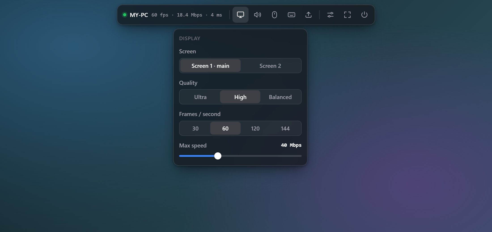
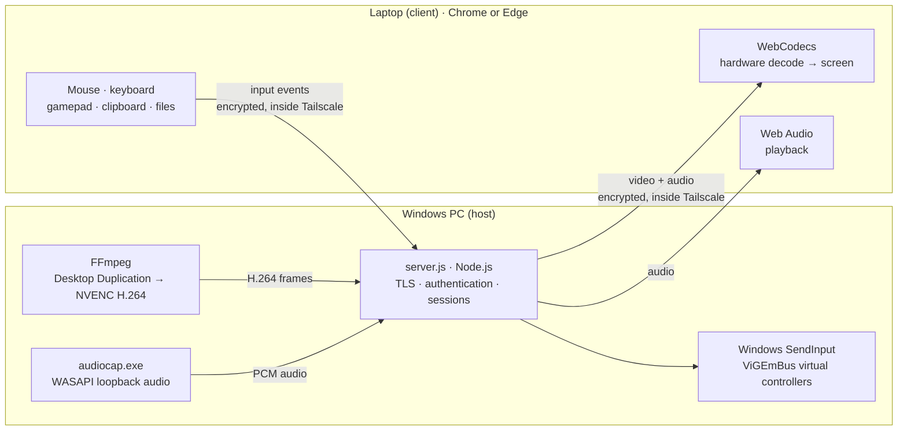
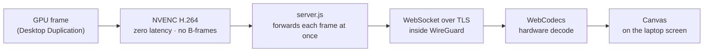
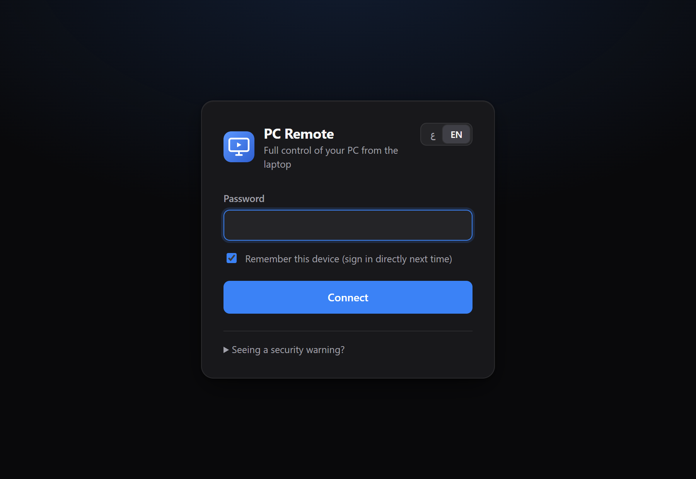
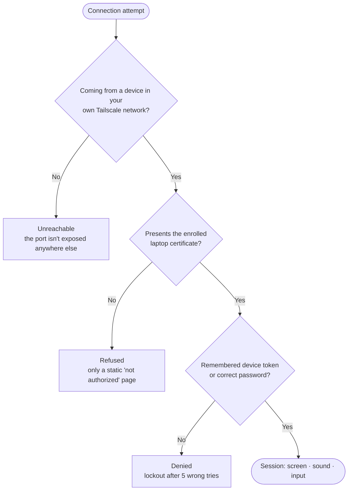

<p align="center">
  
</p>

<h1 align="center">PC Remote</h1>

<p align="center">
  <b>A private, low-latency remote desktop for your own Windows PC.</b><br>
  Control it from your laptop's browser, from any network. Only <i>your</i> laptop can get in.
</p>

<p align="center">
  <a href="README.ar.md"><b>العربية</b></a> ·
  <a href="#install">Install</a> ·
  <a href="#how-it-works">How it works</a> ·
  <a href="#security-at-a-glance">Security</a> ·
  <a href="#faq">FAQ</a>
</p>

<p align="center">
  
  
  
  
</p>

<p align="center">
  
</p>

---

## Why PC Remote

- **Feels local.** The screen is captured and encoded on the GPU, decoded by the laptop's GPU, and sent the moment each frame exists. Nothing is re-encoded or relayed through a company's servers.
- **Yours only.** Three independent locks: a private network, a device certificate that only your laptop holds, and a password. A stranger fails at the first one, and even someone with your password fails at the second.
- **No "accept connection?" prompt.** It's your computer, so it connects right away. That's also why it must only be installed on computers you own.
- **Nothing to install on the laptop** except Tailscale and a certificate. The app runs in Chrome or Edge, and you can install it as an app window.

## Features

| | |
|---|---|
| **Video** | Up to 144 fps · three quality levels · speed cap from 5 to 120 Mbps · automatic slow-down when the network can't keep up |
| **Screens** | Switch between monitors · sharp scaling to any laptop resolution |
| **Keyboard** | Every key, including Win, Alt+Tab and Esc in fullscreen · typing follows the PC's keyboard layout (Arabic, English…) |
| **Mouse** | Precise absolute pointer · **game mode** with pointer lock and raw relative movement |
| **Sound** | The PC's audio plays on the laptop |
| **Controllers** *(beta)* | A gamepad plugged into the laptop appears on the PC as an Xbox 360 controller, with rumble |
| **Clipboard** | Text copied on either side is available on the other |
| **Files** | Drag and drop onto the screen to send files to the PC (`Downloads\PCRemote`) |
| **USB drives** *(experimental)* | A USB drive in the laptop can be opened on the PC as drive `U:` |
| **Interface** | Auto-hiding floating toolbar · Arabic and English · dark, light or automatic theme · accent colors |
| **Always on** | Starts with Windows sign-in, restarts itself if it crashes, keeps the PC awake while you're connected |

---

## How it works



1. **Capture.** FFmpeg's `ddagrab` uses the Windows Desktop Duplication API to grab each frame directly on the graphics card, so the CPU barely works.
2. **Encode.** The GPU's dedicated video encoder (NVENC) compresses each frame to H.264 in zero-latency mode, with no B-frames, so no frame waits for another. A new keyframe is made only when needed.
3. **Send.** `server.js` reads FFmpeg's output and forwards every frame the moment it's produced, over a WebSocket with Nagle's delay turned off.
4. **Protect.** That WebSocket is TLS-encrypted and runs inside Tailscale's WireGuard tunnel. Only the laptop holding the enrolled certificate is let in.
5. **Decode and draw.** The browser decodes with the laptop's GPU (WebCodecs) and draws to a canvas. If decoding ever falls behind, it skips ahead to the next keyframe instead of building up delay.
6. **Control.** Mouse, keyboard and gamepad events travel back as tiny binary messages and are replayed with Windows `SendInput` or the ViGEmBus driver.
7. **Adapt.** If the network can't keep up, the PC pauses the stream, lets the queue drain, and resumes at 70% of the previous speed with a fresh keyframe. You see a short notice instead of growing lag.

The video path, step by step:



Audio follows the same idea: the PC's sound output is captured with WASAPI loopback and sent in 20 ms pieces. The laptop plays them back to back, and a piece that arrives late is dropped rather than queued, so sound never drifts behind the picture.

---

## Requirements

| | PC (the computer you control) | Laptop (the computer you use) |
|---|---|---|
| **System** | Windows 10 or 11, 64-bit | Windows 10 or 11 recommended<sup>1</sup> |
| **Hardware** | NVIDIA graphics card with NVENC (GeForce GTX 900 series or newer, any RTX) and an up-to-date driver | Any laptop that can play HD video |
| **Software** | Installed automatically: Node.js LTS, FFmpeg, Tailscale (and ViGEmBus if you want controllers) | Chrome or Edge (current version), Tailscale |
| **Account** | A free [Tailscale](https://tailscale.com) account, the same one on both devices | ← same account |
| **Network** | Upload speed of 10–40 Mbps for 1080p at 60 fps (adjustable down to 5 Mbps) | Same, as download speed |
| **Rights** | Administrator rights for the one-time install | Permission to install a certificate for your user |

<sup>1</sup> The one-click certificate installer is a Windows script. macOS and Linux with Chrome should work if you import the `.p12` certificate yourself, but they're untested.

AMD and Intel graphics aren't supported yet (the encoder is NVENC-only).

---

## Install

### 1 · On the PC

1. Download the latest release ZIP from **Releases**, or use **Code → Download ZIP**.
2. Before extracting, right-click the ZIP → **Properties** → tick **Unblock** → OK. This stops Windows warnings about files from the internet.
3. Extract it to a permanent folder, for example `C:\PCRemote`. The autostart runs from this folder, so don't leave it in Downloads.
4. Double-click **`install.bat`** and click **Yes** on the administrator prompt.

The installer explains each step as it goes. It:

| Step | What happens |
|---|---|
| Node.js and packages | Installs Node.js LTS with `winget` if it's missing, then the exact package versions from `package-lock.json` |
| FFmpeg | Downloads the official Windows build (≈110 MB) into `bin\` |
| Controllers *(optional)* | Asks whether to install the ViGEmBus driver. Answer `y` if you want gamepad support |
| Password | Asks you to choose a password, at least 8 characters. You'll type it once on the laptop |
| Tailscale | Installs Tailscale and opens a browser window to sign in |
| Private address | Configures PC Remote to listen **only** on the PC's Tailscale address |
| Laptop certificate | Creates your laptop's personal certificate in `data\enroll` |
| Firewall | Allows port 9443 **only** from Tailscale addresses |
| Autostart | Registers a scheduled task named **PCRemote** that starts at sign-in, then starts it now |

At the end, it opens the `data\enroll` folder and prints your PC's address, for example `https://my-pc.tailxxxx.ts.net:9443`.

### 2 · On the laptop

1. Install [Tailscale](https://tailscale.com/download) and sign in with **the same account** as the PC.
2. Move the `enroll` folder from the PC to the laptop privately: a USB drive, or Tailscale's file sharing (*Send with Tailscale*). Don't email it or put it in cloud storage, because it contains your laptop's key.
3. Run **`install-on-laptop.bat`** from that folder and click **Yes** if Windows asks to trust the certificate.
4. **Delete the `enroll` folder** from the laptop and from the PC once it's installed.

### 3 · Connect

1. Close **every** Chrome/Edge window, then open the browser again so it picks up the certificate.
2. Go to the address the installer printed (`https://<your-pc>.<your-tailnet>.ts.net:9443`).
3. If the browser asks which certificate to use, choose **PCRemote Laptop**.
4. Enter your password and keep **Remember this device** ticked. From now on the laptop connects straight away.
5. Optional: browser menu → **Install as app** for an app window and a desktop icon.

<p align="center">
  
</p>

### Update

Download the new version and extract it over your existing folder. Keep the `data\` folder, which holds your settings and keys. Then run `install.bat` again. Your laptop keeps working; you don't need to reinstall its certificate.

### Uninstall

1. On the PC, run **`uninstall.bat`**. It stops PC Remote and removes its autostart task and firewall rule. Then delete the folder. Tailscale and ViGEmBus can be removed from *Settings → Apps*.
2. On the laptop, open `certmgr.msc` and delete **PCRemote Laptop** (*Personal → Certificates*) and **PCRemote Local CA (…)** (*Trusted Root Certification Authorities → Certificates*).

---

## Using PC Remote

Move the mouse to the **top edge** of the screen, or press **Ctrl + Alt + Shift + M**, to bring up the toolbar. It hides itself when you move away. To keep it visible, turn on *Settings → Keep toolbar visible*.

| Toolbar | What it does |
|---|---|
| ● PC name · fps · Mbps · ms | Connection status and live speed and latency |
| **Display** | Monitor, quality (Ultra / High / Balanced), frames per second (30 / 60 / 120 / 144), maximum speed |
| **Sound** | Mute or unmute. The icon turns red when muted |
| **Mouse** | Show the laptop's cursor · **Game mode** (locks the mouse inside the screen for games; leave it with Ctrl+Alt+Shift+M) |
| **Shortcuts** | Win · Alt+Tab · Alt+F4 · Task Manager · Desktop · File Explorer · Screenshot · switch keyboard language |
| **Send file** | Pick files to send, or drag them onto the screen. They arrive in `Downloads\PCRemote` |
| **Settings** | Appearance · accent color · language · keep toolbar visible · statistics · forget this device |
| **Fullscreen** | In fullscreen, Win, Alt+Tab, Esc and the rest go to the PC. Hold **Esc** to leave |
| **Disconnect** | Ends the session |

**Tips**

- **Sound** starts after your first click or key press on the page. Browsers require one interaction before playing audio.
- **Typing** uses the PC's keyboard layout. Switch it with Alt+Shift or the *keyboard language* shortcut.
- **Clipboard:** the first time, the browser asks for clipboard permission. Choose Allow.
- **Controllers:** plug the gamepad into the laptop and press any button while the PC Remote page is focused. A notice confirms it's connected.
- **Smoothest picture:** at home, 60 fps with High quality and 40 Mbps. On mobile data, try 60 fps at 10–15 Mbps. 120 or 144 fps needs a strong connection.

### Use a laptop USB drive on the PC *(experimental)*

This shares a USB drive from the laptop over Tailscale, so it opens on the PC as drive `U:`. It works for files only; programs that need a real USB device (license dongles, boot-drive creators) won't see it.

On the **laptop**, in an administrator PowerShell, replace `E:` with the drive's letter and the IP address with your PC's Tailscale IP (shown in the Tailscale app):

```powershell
New-SmbShare -Name USB -Path 'E:\' -ChangeAccess "$env:USERDOMAIN\$env:USERNAME"
New-NetFirewallRule -DisplayName 'PC Remote USB share' -Direction Inbound -Action Allow -Protocol TCP -LocalPort 445 -RemoteAddress 100.x.y.z
```

Your laptop's Windows account needs a password. Then on the **PC**, run **`connect-usb.bat`**, type the laptop's Tailscale name, and sign in with the laptop's username and password.

### Things to know

- **Windows must be signed in and unlocked.** Windows deliberately keeps the lock screen and the dimmed administrator prompt (UAC secure desktop) out of reach of screen capture. Don't lock the PC with Win+L while you plan to use it remotely.
  - To use the PC after a restart without touching it, you can enable automatic sign-in (`netplwiz`). This means anyone who can physically reach the PC gets in too.
  - To approve administrator prompts remotely, set UAC to *"Notify me… (do not dim my desktop)"*. This removes the dimmed screen that protects those prompts from being faked, which slightly weakens UAC.
- **Ctrl+Alt+Del** can't be sent (Windows blocks it); use the Task Manager shortcut.
- **One laptop at a time.** A new connection takes over from the current one.
- **Audio** goes from the PC to the laptop only; the laptop's microphone isn't sent.

---

## Security at a glance



| Layer | What it does |
|---|---|
| **1. Private network** | PC Remote listens only on the PC's Tailscale address, and the firewall rule only admits Tailscale addresses. Nothing is exposed to the internet or to your home Wi-Fi. Never forward a port on your router. |
| **2. Device certificate** | During the TLS handshake the PC asks for a client certificate. Every request that doesn't carry the one enrolled laptop certificate (matched by its SHA-256 fingerprint) is refused before any app code runs. That device never sees the app or the password prompt, even if it knows the password. |
| **3. Password** | At least 8 characters, stored as a salted scrypt hash. Lockout after 5 failed tries per address, plus a global limit. A remembered laptop uses a random 256-bit token, and the PC stores only its hash. |
| **Everything encrypted** | TLS inside WireGuard, so two layers of encryption. Your own certificate authority, restricted to private and Tailscale addresses. Strict browser security headers. WebSocket origin check. |
| **Privacy** | No telemetry, no analytics, no update checks, no accounts besides your own Tailscale. Logs stay on the PC (`data\pcremote.log`). |

**Lost your laptop?** Run **`new-laptop-certificate.bat`** on the PC. The old certificate stops working immediately, even with the password. Set up the new laptop with the fresh `data\enroll` folder.

**Read the full threat model, cryptography details and limitations in [docs/SECURITY.md](docs/SECURITY.md).**

---

## Troubleshooting

<details>
<summary><b>"Device not authorized" page</b></summary>

The browser isn't presenting the laptop certificate. Run `install-on-laptop.bat` again from a fresh `data\enroll` folder (re-run `install.bat` on the PC to regenerate it), then close **every** browser window and reopen. Use the same Windows user and browser profile you installed the certificate into.
</details>

<details>
<summary><b>The page doesn't load at all</b></summary>

- Check that Tailscale shows *Connected* on **both** devices, signed in to the same account.
- Check that PC Remote is running: look at `data\pcremote.log` on the PC, or run `start.bat` to watch it live.
- Use the full address with `:9443`.
</details>

<details>
<summary><b>"The PC screen isn't available right now"</b></summary>

The PC is on the lock screen or showing a dimmed administrator prompt. Sign in at the PC. The picture comes back automatically.
</details>

<details>
<summary><b>Choppy or delayed picture</b></summary>

Lower the frames per second to 60 and the maximum speed in *Display*. Turn on *Settings → Statistics* to watch fps, speed and latency. On Wi-Fi, being closer to the router helps more than anything else.
</details>

<details>
<summary><b>No sound</b></summary>

Click once on the page (browsers need one interaction before playing audio), check that the sound icon isn't red, and make sure the PC is playing to its default output device.
</details>

<details>
<summary><b>Controller isn't detected</b></summary>

Keep the PC Remote page focused and press a button on the controller. If you see "Controller support is not enabled", run `install.bat` on the PC and answer `y` to the controller question.
</details>

<details>
<summary><b>Forgot the password</b></summary>

Run `set-password.bat` on the PC. Every remembered device is signed out and must use the new password.
</details>

---

## FAQ

<details>
<summary><b>Why is it distributed as scripts and source code instead of an .exe installer?</b></summary>

- **You can read exactly what runs as administrator.** For software that gives full control of a computer, being able to review every line is the strongest guarantee there is.
- **Unsigned remote-control executables get flagged.** SmartScreen and antivirus programs routinely warn about or quarantine them. Plain scripts plus official installers from Microsoft's `winget` avoid that.
- **No bundled third-party binaries.** The installer downloads official builds (Node.js, FFmpeg, Tailscale), pinned and verified where possible, and compiles the two small helper programs from the C# source in `lib/` on your own PC.
</details>

<details>
<summary><b>Does my screen pass through anyone's server?</b></summary>

No. Tailscale's coordination service only helps your two devices find each other. The stream goes directly between them, or through Tailscale's relay when a direct path isn't possible. The relay only forwards encrypted packets it can't read.
</details>

<details>
<summary><b>Do I need to open ports on my router?</b></summary>

No, and you shouldn't. Tailscale connects the devices without any port forwarding.
</details>

<details>
<summary><b>Can I use two laptops, a phone or a tablet?</b></summary>

By design, one enrolled laptop at a time. To move access to another laptop, run `new-laptop-certificate.bat`. Phones and tablets aren't supported.
</details>

<details>
<summary><b>How much does it cost?</b></summary>

Nothing. PC Remote is MIT-licensed, and Tailscale's free Personal plan is enough.
</details>

---

## Project layout

| Path | Purpose |
|---|---|
| `install.bat` · `install.ps1` | Install, update or repair (runs as administrator) |
| `uninstall.bat` | Stop PC Remote and remove its autostart task and firewall rule |
| `set-password.bat` | Change the password (signs out remembered devices) |
| `new-laptop-certificate.bat` | Issue a new laptop certificate and revoke the old one |
| `connect-usb.bat` | Open a laptop's shared USB drive as `U:` *(experimental)* |
| `start.bat` | Run in a visible console window (for watching the log) |
| `start-hidden.vbs` | Background launcher used by autostart; restarts after a crash |
| `server.js` | The host: HTTPS and WebSocket server, authentication, sessions |
| `lib/encoder.js` | Runs FFmpeg (Desktop Duplication → NVENC) and splits its output into frames |
| `lib/certs.js` | Certificate authorities, server and laptop certificates, the laptop bundle |
| `lib/input.js` · `lib/win.js` | Mouse and keyboard via `SendInput`; monitors, clipboard, DPI, keep-awake |
| `lib/audio.js` · `lib/audiocap.cs` | System audio capture (WASAPI loopback) |
| `lib/gamepad.js` · `lib/gamepad.cs` | Virtual Xbox 360 controllers through ViGEmBus |
| `public/` | The browser app: interface, video decoding, input, Arabic and English text |
| `data/` | **Created on install, private:** settings, password hash, keys, certificates, log. Never share it |
| `bin/` | Created on install: `ffmpeg.exe` and the compiled helpers |

---

## Responsible use

PC Remote gives full control of the computer it's installed on, **without asking anyone at that computer.** Only install it on computers you own or are explicitly authorized to administer. Accessing someone else's computer without permission is illegal in most countries.

It's built to be visible, not hidden: it runs as a scheduled task named **PCRemote**, adds a firewall rule named **PCRemote**, and records every session and failed sign-in in `data\pcremote.log`.

## Third-party software

| Component | Used for | License | How it reaches your PC |
|---|---|---|---|
| [FFmpeg](https://ffmpeg.org) (gyan.dev build) | Screen capture and NVENC encoding | GPL-3.0 | Downloaded by the installer |
| [Tailscale](https://tailscale.com) | Private encrypted network | See tailscale.com | `winget` |
| [Node.js](https://nodejs.org) | Runtime for the host | MIT | `winget` |
| [ws](https://github.com/websockets/ws) · [koffi](https://koffi.dev) · [node-forge](https://github.com/digitalbazaar/forge) | WebSocket · Windows API calls · certificates | MIT · MIT · BSD-3-Clause or GPL-2.0 | `npm ci` (locked versions) |
| [ViGEmBus](https://github.com/nefarius/ViGEmBus) + [Nefarius.ViGEm.Client](https://github.com/ViGEm/ViGEm.NET) | Virtual controllers *(optional)* | BSD-3-Clause · MIT | `winget` · NuGet, pinned and hash-verified |

## License

[MIT](LICENSE)
