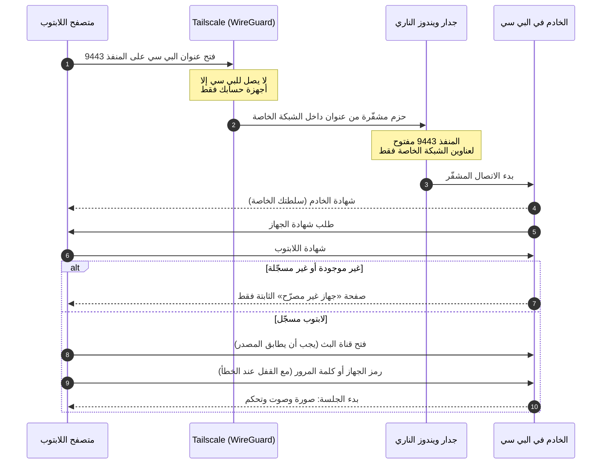

# الأمان

[English](SECURITY.md) · [العودة إلى الصفحة الرئيسية](../README.ar.md)

يعطي PC Remote تحكماً كاملاً بجهاز ويندوز بدون أي نافذة موافقة، لذلك الأمان هو أساس التصميم وليس إضافة عليه. يشرح هذا المستند بالضبط ما الذي يحمي الجهاز، وكيف تعمل كل حماية، وأين حدودها.

## الإبلاغ عن ثغرة

من فضلك **لا تفتح issue عاماً** لمشاكل الأمان. استخدم الإبلاغ الخاص في GitHub: تبويب **Security** في المستودع ← **Report a vulnerability**. اذكر خطوات إعادة المشكلة والإصدار الذي اختبرته.

---

## أهداف التصميم

1. **الجهاز غير مرئي.** لا يمكن الوصول للبي سي من الإنترنت ولا من الشبكة المحلية.
2. **جهاز واحد فقط.** لا يتصل إلا لابتوب واحد محدد، حتى لو تسرّبت كلمة المرور.
3. **تشفير من طرف إلى طرف.** لا أحد بين الجهازين يستطيع قراءة أو تغيير أي شيء.
4. **بدون وسيط.** لا يرى أي طرف ثالث الشاشة ولا الصوت ولا ضغطات المفاتيح.
5. **الرفض عند الشك.** إذا نقص شيء أو كان خاطئاً (Tailscale متوقف، أو لا توجد شهادة، أو المصدر غير صحيح)، فالجواب «لا».

## نموذج التهديدات

| من | هل يستطيع الوصول إلى PC Remote؟ | السبب |
|---|---|---|
| أي شخص على الإنترنت | **لا** | لا شيء يستمع على عنوان عام، ولا يوجد منفذ مفتوح في الراوتر. قاعدة الجدار الناري لا تقبل إلا عناوين Tailscale. |
| شخص على شبكة البيت أو العمل | **لا** | الخادم مربوط بعنوان Tailscale الخاص بالبي سي فقط، والمنفذ غير موجود على الشبكة المحلية. |
| جهاز آخر داخل شبكة Tailscale الخاصة بك، أو جهاز تمت مشاركته فيها | يستطيع فتح اتصال، **ثم يُرفض** | لا يحمل شهادة جهاز مسجّلة. كل طلب منه يُرد عليه بصفحة «غير مصرّح» ثابتة، وطلبات WebSocket تُرفض. |
| شخص يعرف كلمة مرورك أو يخمّنها | **لا** | كلمة المرور لا تُفحص إلا بعد فحص الشهادة، ولا يستطيع تجاوزه بدون المفتاح الخاص بلابتوبك. |
| موقع خبيث مفتوح في متصفح اللابتوب | **لا** | WebSocket لا يقبل إلا مصدره الخاص، ولا يمكن تضمين الصفحة في إطار، ورفع الملفات يحتاج سراً خاصاً بالجلسة. |
| لص يحمل لابتوبك وهو **غير مقفل** | **ممكن** | اللابتوب هو المفتاح. احمِه بكلمة مرور ويندوز و BitLocker، وألغِ شهادته فوراً بـ `new-laptop-certificate.bat`. |
| برنامج خبيث يعمل أصلاً على اللابتوب أو البي سي | خارج النطاق | البرنامج الخبيث الذي يعمل باسمك يستطيع فعل كل ما تستطيعه. حدّث النظامين باستمرار. |
| شخص يصل للبي سي فعلياً | خارج النطاق | تسجيل الدخول في ويندوز هو ما يحمي الجهاز. راجع *تسجيل الدخول التلقائي* أدناه. |

---

## الطبقة 1 · عزل الشبكة

- **Tailscale (WireGuard).** يتواصل الجهازان عبر نفق WireGuard مشفّر (تبادل مفاتيح Curve25519 وتشفير ChaCha20-Poly1305). عندما يتعذر المسار المباشر، تنقل خوادم الترحيل في Tailscale الحزم المشفّرة أصلاً ولا تستطيع قراءتها.
- **الربط بـ Tailscale فقط.** يربط الخادم نفسه بعنوان IPv4 الخاص بالبي سي في Tailscale (`100.x.y.z`). إذا لم يكن Tailscale متصلاً، فلا يستمع على أي عنوان، بل ينتظر حتى يتصل Tailscale ثم يرتبط به.
- **قاعدة الجدار الناري.** ينشئ المثبّت قاعدة واحدة للاتصالات الواردة باسم **PCRemote**: منفذ TCP رقم 9443، ومن عناوين `100.64.0.0/10` (نطاق Tailscale) فقط. ويحذف أيضاً قواعد «السماح لـ node.exe» العامة التي قد يكون ويندوز أنشأها من نوافذ سابقة.
- **يُنصح:** قيّد شبكتك بـ [قواعد الوصول في Tailscale](https://tailscale.com/kb/1018/acls) بحيث لا يصل للبي سي على المنفذ 9443 إلا لابتوبك.

## الطبقة 2 · شهادة الجهاز (TLS المتبادل)

ينشئ المثبّت سلطتي شهادات خاصتين **على البي سي**، ومفاتيحهما لا تغادره أبداً.

| | سلطة الخادم | سلطة الأجهزة |
|---|---|---|
| الاسم | `PCRemote Local CA (<اسم-البي-سي>)` | `PCRemote Device CA` |
| توقّع | شهادة HTTPS الخاصة بالبي سي | شهادة اللابتوب |
| المفتاح | RSA-2048، وتوقيع SHA-256 | RSA-2048، وتوقيع SHA-256 |
| الصلاحية | 10 سنوات | 10 سنوات |
| القيود | `pathLen 0` و **قيود أسماء** (Name Constraints) إلزامية | `pathLen 0` |

**لماذا قيود الأسماء مهمة؟** تثبيت شهادة جذر خاصة على اللابتوب خطير عادة، لأن من يملك مفتاحها يستطيع انتحال أي موقع على ذلك اللابتوب. لكن سلطة الخادم هنا مقيّدة بالعناوين الخاصة (`10/8` و `172.16/12` و `192.168/16` و `100.64/10` و `169.254/16` و `127/8`) وبالأسماء المحلية (`localhost` و `.local` و `.ts.net` و `.home.arpa` و `.lan` واسم البي سي نفسه). فحتى لو سُرق مفتاحها، لا يمكن استخدامها لانتحال `google.com` أو موقع بنكك.

**شهادة الخادم.** صالحة 825 يوماً، وتتجدد تلقائياً قبل انتهائها بـ 30 يوماً أو كلما تغيّرت عناوين البي سي. وتغطي اسم MagicDNS وعنوان IP في Tailscale.

**شهادة اللابتوب.** شهادة عميل (للاستخدام `clientAuth`، بمفتاح RSA-2048، صالحة 10 سنوات)، مجمّعة مع سلسلتها في ملف `.p12`. ملف `.p12` محمي بكلمة مرور عشوائية بطول 72 بت مكتوبة داخل `install-on-laptop.bat`، وهذا يجعل مجلد `enroll` كاملاً سراً: انقله بطريقة خاصة واحذفه بعد التثبيت. يستخدم ملف `.p12` تشفير 3DES لأنه ما يقبله استيراد الشهادات في ويندوز بشكل موثوق.

**التطبيق.**

1. في كل اتصال TLS يطلب الخادم شهادة من العميل.
2. يجب أن ترتبط الشهادة بسلطة الأجهزة، **و** أن تكون بصمتها (SHA-256) مسجّلة في `config.enrolledClients`. التوقيع من سلطة الأجهزة وحده لا يكفي، فحتى لو سُرق مفتاح سلطة الأجهزة لا يمكن صنع شهادة تعمل.
3. هذا الفحص يحدث **أولاً**: قبل تقديم أي ملف من التطبيق، وقبل قبول WebSocket، وقبل قراءة أي رسالة، وقبل فحص كلمة المرور. الجهاز الذي يفشل فيه لا يستلم إلا صفحة `403` واحدة ثابتة ومستقلة.

**الإلغاء.** يصدر `new-laptop-certificate.bat` شهادة جديدة للابتوب ويستبدل البصمة المسجّلة. الخادم يراقب إعداداته، ويغلق فوراً أي جلسة شهادتها لم تعد مسجّلة، وتُرفض الشهادة القديمة بعدها.

**أول تثبيت.** قبل تسجيل أي لابتوب يكون الدخول بكلمة المرور فقط، فلا تُقفل خارج جهازك أثناء الإعداد. المثبّت يسجّل شهادة اللابتوب فوراً، ومن تلك اللحظة تصبح الشهادة إلزامية.

## الطبقة 3 · التحقق من الهوية

- **كلمة المرور.** 8 أحرف على الأقل. تُحفظ كتجزئة scrypt (القيم الافتراضية في Node.js: N = 16384 و r = 8 و p = 1، مع ملح عشوائي بطول 16 بايت ومخرج بطول 32 بايت)، وتُقارن بزمن ثابت. كلمة المرور نفسها لا تُكتب على القرص أبداً.
- **الجهاز المحفوظ.** بعد دخول ناجح مع خيار *تذكّر هذا الجهاز*، يستلم المتصفح رمزاً عشوائياً بطول 256 بت يُحفظ في تخزينه المحلي، ولا يحفظ البي سي إلا تجزئة SHA-256 له. خيار *نسيان هذا الجهاز* يحذفه، و `set-password.bat` يلغي كل الرموز.
- **القفل.** لكل عنوان: بعد 5 كلمات مرور خاطئة يُمنع الدخول 30 ثانية، وتتضاعف المدة مع كل فشل إضافي حتى 15 دقيقة. ولكل العناوين معاً: 20 محاولة فاشلة خلال 15 دقيقة تمنع كل محاولات كلمة المرور. اللابتوب المحفوظ يظل يدخل، فلا يستطيع المهاجم إقفالك خارج جهازك.
- **مهلة.** يجب أن يتم التحقق خلال 10 ثوانٍ من فتح الاتصال، وإلا يُغلق.
- **جلسة واحدة.** الدخول الجديد يأخذ مكان الجلسة الحالية، ويُبلَّغ الطرف السابق بالسبب.

## تحصين النقل والويب

- **طبقتا تشفير.** HTTPS/WSS (بـ TLS 1.2 أو أحدث، و TLS 1.3 مع المتصفحات الحالية) داخل نفق WireGuard.
- **فحص المصدر.** لا يُقبل WebSocket إلا إذا كان `Origin` مطابقاً لعنوان الصفحة نفسها، وهذا يمنع اختطاف WebSocket من مواقع أخرى.
- **الترويسات.** `Content-Security-Policy: default-src 'self'` (لا سكربتات من أطراف ثالثة ولا سكربتات مضمّنة) · `Strict-Transport-Security` · `X-Frame-Options: DENY` · `X-Content-Type-Options: nosniff` · `Referrer-Policy: no-referrer`.
- **بدون كوكيز.** التحقق رسالة عبر WebSocket الذي تم التحقق منه أصلاً، فلا يوجد ما يستغله موقع آخر.
- **رفع الملفات** يحتاج الشهادة المسجّلة **و** السر العشوائي للجلسة الحالية معاً. أسماء الملفات تُنظّف، ولا يُستبدل أي ملف موجود، وكل شيء يُحفظ في `Downloads\PCRemote`.
- **الحدود.** أقصى حجم للرسالة 16 ميجابايت، ونص الحافظة حتى مليوني حرف.
- **الاتصال الحي.** يرسل الخادم نبضة كل 3 ثوانٍ، ويقطع الاتصال الصامت خلال 6 إلى 9 ثوانٍ تقريباً. وعند الانقطاع تُفلت كل المفاتيح وأزرار الماوس المضغوطة على البي سي.

## الصلاحيات على البي سي

يعمل PC Remote **بصلاحيات مرتفعة** (مهمة مجدولة بأعلى الصلاحيات). ويندوز يمنع البرامج العادية من إرسال إدخال إلى نوافذ المدير مثل مدير المهام وبرامج التثبيت، وبدون هذه الصلاحيات لن تستطيع استخدامها عن بُعد.

النتيجة: من يتجاوز الطبقات الثلاث يتحكم بالبي سي بصلاحيات مدير. هذا هو الغرض من سطح مكتب بعيد شخصي، ولهذا وُجدت الطبقات. وقبل التحقق، كل ما يمكن الوصول إليه هو مصافحة TLS وفحص الشهادة.

## تسلسل الاتصال

## ماذا يُحفظ وأين

**على البي سي** في مجلد `data\` (مستبعد من Git عبر `.gitignore`، ولا تشاركه أبداً):

| الملف | يحتوي | الحساسية |
|---|---|---|
| `config.json` | تجزئة كلمة المرور، وتجزئات رموز الأجهزة المحفوظة، وبصمة الشهادة المسجّلة، والإعدادات | عالية |
| `certs\ca.key` · `certs\clientca.key` | المفاتيح الخاصة لسلطتي الشهادات | عالية |
| `certs\server.key` | مفتاح خادم HTTPS | عالية |
| `certs\client.key` | نسخة من المفتاح الخاص للابتوب، تُستخدم لإعادة بناء حزمة `enroll` | عالية |
| `enroll\` | حزمة اللابتوب: ملف `.p12` وسكربت التثبيت الذي يحتوي كلمة مروره | عالية: احذفها بعد الاستخدام |
| `pcremote.log` | أوقات بدء الجلسات وانتهائها، وعناوين Tailscale، وأسماء الأجهزة، ومحاولات الدخول الفاشلة | متوسطة |

**على اللابتوب:** شهادة اللابتوب ومفتاحها الخاص في مخزن شهادات المستخدم في ويندوز (*Personal*)، وسلطة الخادم في *Trusted Root Certification Authorities*، ورمز الجهاز المحفوظ وتفضيلات الواجهة في التخزين المحلي للمتصفح.

## الخصوصية

- لا تتبّع، ولا إحصاءات، ولا تقارير أعطال، ولا فحص تحديثات. PC Remote لا يتصل بأي خادم خاص به أبداً.
- البث يمر بين جهازيك فقط، مشفّراً، إما مباشرة أو عبر مرحّل Tailscale الذي لا يستطيع قراءته.
- السجلات تبقى على البي سي.

## سلسلة التوريد

- **حزم npm** (`ws` و `koffi` و `node-forge`) تُثبّت بـ `npm ci` من ملف `package-lock.json` الموجود في المستودع، فالإصدارات وتجزئات السلامة ثابتة.
- **Nefarius.ViGEm.Client** (لدعم يد التحكم) يُحمّل من NuGet بإصدار ثابت ويُتحقق منه بتجزئة SHA-256 قبل الاستخدام.
- **FFmpeg** يُحمّل عبر HTTPS من gyan.dev، وهي نسخة ويندوز المذكورة في موقع ffmpeg.org. لا يُتحقق منه بتجزئة ثابتة لأن الرابط يشير دائماً لآخر إصدار، ويمكنك استبدال `bin\ffmpeg.exe` بنسخة تثق بها.
- **Node.js و Tailscale و ViGEmBus** تُثبّت عبر `winget` من المثبّتات الموقّعة من ناشريها.
- **لا توجد ملفات تنفيذية جاهزة في هذا المستودع.** البرنامجان المساعدان (`audiocap.exe` و `gamepad.exe`) يُبنيان على جهازك من كود C# الموجود في `lib/` بالمترجم المرفق مع ويندوز.

## القيود المعروفة

- **اللابتوب هو المفتاح.** إذا سُرق وهو غير مقفل، أو اختُرق حساب ويندوز فيه، يستطيع المهاجم الاتصال. واللابتوب المحفوظ لا يطلب كلمة المرور، وهذه هي الراحة المقصودة.
- **لا نافذة موافقة على البي سي.** مقصود لأن الجهاز جهازك، ولهذا بالذات يجب ألا يُثبّت PC Remote على جهاز شخص آخر أبداً.
- **مفاتيح RSA-2048** وملف **`.p12` بتشفير 3DES.** كلاهما اختيار للتوافق، وملف `.p12` مؤقت ويجب حذفه بعد الاستخدام.
- **`.ts.net` ضمن قيود الأسماء.** مفتاح سلطة الخادم إذا سُرق يمكن أن ينتحل أجهزة `*.ts.net` أخرى على لابتوبك. احفظ مجلد `data\` بعيداً عن الآخرين.
- **ViGEmBus مؤرشف** من صاحبه ولم يعد يُحدّث. هو اختياري ولا يُثبّت إلا إذا طلبت دعم يد التحكم.
- **شاشة القفل والسطح الآمن.** ويندوز لا يسمح بالتقاطهما. وإذا فعّلت **تسجيل الدخول التلقائي** للاستخدام بعد إعادة التشغيل، فكل من يصل للبي سي فعلياً يدخل أيضاً.
- **UAC بدون تعتيم.** الموافقة على نوافذ صلاحيات المدير عن بُعد تتطلب إيقاف الشاشة المعتمة، وهذا يزيل حماية UAC من النوافذ المزيّفة.

## قائمة التحصين

- [ ] استخدم كلمة مرور طويلة لا تستخدمها في أي مكان آخر.
- [ ] احمِ اللابتوب بتسجيل دخول قوي في ويندوز وفعّل BitLocker.
- [ ] فعّل التحقق بخطوتين للحساب الذي تستخدمه مع Tailscale.
- [ ] قيّد شبكتك بقواعد الوصول في Tailscale.
- [ ] لا تفتح المنفذ 9443 (ولا أي منفذ) في الراوتر أبداً.
- [ ] احذف مجلد `enroll` بعد إعداد اللابتوب.
- [ ] راجع `data\pcremote.log` من وقت لآخر.
- [ ] حدّث ويندوز وتعريف كرت الشاشة و Node.js و Tailscale باستمرار.

