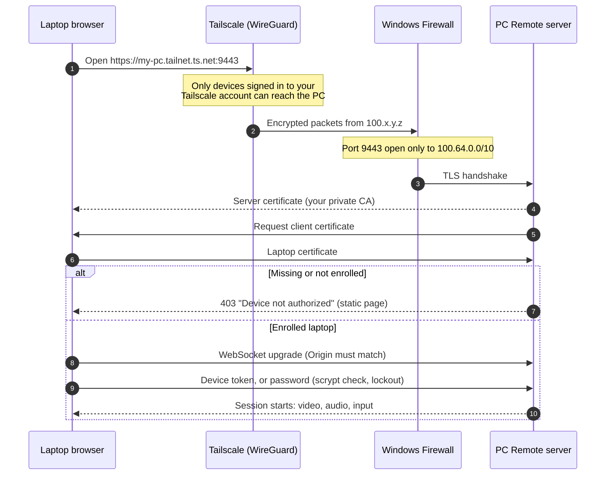

# Security

[العربية](SECURITY.ar.md) · [Back to README](../README.md)

PC Remote gives full, prompt-free control of a Windows PC, so security is its main design constraint, not an add-on. This document explains exactly what protects that PC, how each protection works, and where the limits are.

## Reporting a vulnerability

Please **don't open a public issue** for security problems. Use GitHub's private reporting instead: the repository's **Security** tab → **Report a vulnerability**. Include steps to reproduce and the version you tested.

---

## Design goals

1. **Invisible.** The PC must not be reachable from the internet or from the local network.
2. **One device.** Only one specific laptop may connect, even if the password leaks.
3. **Encrypted end to end.** No one between the two devices can read or change anything.
4. **No middleman.** No third party ever sees the screen, the sound or the keystrokes.
5. **Fail closed.** If anything is missing or wrong (Tailscale down, no certificate, bad origin), the answer is "no".

## Threat model

| Who | Can they reach PC Remote? | Why |
|---|---|---|
| Anyone on the internet | **No** | Nothing listens on a public address and no router port is forwarded. The firewall rule only admits Tailscale addresses. |
| Someone on your home or office network | **No** | The server binds to the PC's Tailscale address only. On the LAN, the port doesn't exist. |
| Another device in your Tailscale network, or one shared into it | Can open a connection, **then gets refused** | It has no enrolled client certificate. Every request is answered with a static "not authorized" page, and WebSocket upgrades are rejected. |
| Someone who knows or guesses your password | **No** | The password is only checked after the certificate check, which they can't pass without your laptop's private key. |
| A malicious website open in the laptop's browser | **No** | The WebSocket only accepts its own origin, the page can't be framed, and uploads need a per-session secret. |
| A thief with your **unlocked** laptop | **Possibly** | The laptop is the key. Protect it with a Windows password and BitLocker, and revoke it at once with `new-laptop-certificate.bat`. |
| Malware already running on the laptop or the PC | Out of scope | Malware running as you can do anything you can. Keep both systems updated. |
| Someone with physical access to the PC | Out of scope | Windows' own sign-in protects the PC. See *Auto sign-in* below. |

---

## Layer 1 · Network isolation

- **Tailscale (WireGuard).** The two devices talk through an encrypted WireGuard tunnel (Curve25519 key exchange, ChaCha20-Poly1305 encryption). When a direct path isn't possible, Tailscale's relay servers forward the already-encrypted packets and can't read them.
- **Bind to Tailscale only.** The server binds its socket to the PC's Tailscale IPv4 address (`100.x.y.z`). If Tailscale isn't connected, it doesn't listen anywhere; it waits and binds once Tailscale is up.
- **Firewall rule.** The installer creates one inbound rule, **PCRemote**: TCP port 9443, remote addresses `100.64.0.0/10` (Tailscale's range) only. It also removes broad "allow node.exe" rules that Windows may have created from earlier prompts.
- **Recommended:** restrict your tailnet with [Tailscale access controls](https://tailscale.com/kb/1018/acls) so only your laptop may reach the PC on port 9443.

## Layer 2 · Device certificate (mutual TLS)

The installer creates two private certificate authorities **on the PC**. Their keys never leave it.

| | Server CA | Device CA |
|---|---|---|
| Name | `PCRemote Local CA (<pc-name>)` | `PCRemote Device CA` |
| Signs | The PC's HTTPS certificate | The laptop's client certificate |
| Key | RSA-2048, SHA-256 signatures | RSA-2048, SHA-256 signatures |
| Lifetime | 10 years | 10 years |
| Restrictions | `pathLen 0` and critical **Name Constraints** | `pathLen 0` |

**Why name constraints matter.** Installing a private root certificate on a laptop is normally risky: whoever holds its key could impersonate any website to that laptop. The server CA is constrained to private addresses (`10/8`, `172.16/12`, `192.168/16`, `100.64/10`, `169.254/16`, `127/8`) and local names (`localhost`, `.local`, `.ts.net`, `.home.arpa`, `.lan`, the PC's own name). Even with its key, nobody could vouch for `google.com` or your bank.

**Server certificate.** Valid 825 days and renewed automatically 30 days before expiry, or whenever the PC's addresses change. It covers the Tailscale MagicDNS name and IP.

**Laptop certificate.** A client certificate (`clientAuth` usage, RSA-2048, 10 years), packaged with its chain into a `.p12` file. The `.p12` is protected by a random 72-bit password written into `install-on-laptop.bat`. That makes the whole `enroll` folder a secret: move it over a private channel and delete it after installing. The `.p12` uses 3DES encryption because that's what Windows' certificate import reliably accepts.

**Enforcement.**

1. On every TLS connection the server requests a client certificate.
2. The certificate must chain to the Device CA **and** its SHA-256 fingerprint must be listed in `config.enrolledClients`. A certificate merely signed by the Device CA isn't enough, so even a stolen Device CA key can't mint a working certificate.
3. This check runs **first**: before any app file is served, before the WebSocket is accepted, before any JSON is parsed, before the password is checked. A device that fails it only ever receives one static, self-contained `403` page.

**Revocation.** `new-laptop-certificate.bat` issues a new laptop certificate and replaces the enrolled fingerprint. The server watches its configuration and immediately closes any live session whose certificate is no longer enrolled. The old certificate is refused from then on.

**First install.** Before a laptop is enrolled, access is password-only, so you're never locked out during setup. The installer enrolls the laptop certificate immediately, and from that moment the certificate is mandatory.

## Layer 3 · Authentication

- **Password.** At least 8 characters. Stored as an scrypt hash (Node.js defaults: N = 16384, r = 8, p = 1; 16-byte random salt; 32-byte output) and compared in constant time. The plain password is never written to disk.
- **Remembered device.** After a successful sign-in with *Remember this device*, the browser receives a random 256-bit token (kept in its local storage). The PC stores only the token's SHA-256 hash. *Forget this device* deletes it, and `set-password.bat` invalidates all of them.
- **Lockout.** Per source address: after 5 wrong passwords, sign-in is blocked for 30 seconds, doubling with each further failure up to 15 minutes. Globally: 20 failures from any addresses within 15 minutes block all password attempts. A remembered laptop still gets in, so an attacker can't lock you out.
- **Deadline.** A connection must authenticate within 10 seconds of opening or it's closed.
- **One session.** A new sign-in replaces the current session, and the replaced one is told why.

## Transport and web hardening

- **Two layers of encryption.** HTTPS/WSS (TLS 1.2 or newer; TLS 1.3 with current browsers) inside the WireGuard tunnel.
- **Origin check.** The WebSocket is accepted only when its `Origin` matches the page's own host. This blocks cross-site WebSocket hijacking.
- **Headers.** `Content-Security-Policy: default-src 'self'` (no third-party scripts, no inline scripts) · `Strict-Transport-Security` · `X-Frame-Options: DENY` · `X-Content-Type-Options: nosniff` · `Referrer-Policy: no-referrer`.
- **No cookies.** Authentication is a message over the already-verified WebSocket, so there's nothing for another site to ride on.
- **File uploads** need both the enrolled certificate and the current session's random secret. File names are sanitized, existing files are never overwritten, and everything lands in `Downloads\PCRemote`.
- **Limits.** 16 MB maximum message size; clipboard text up to 2 million characters.
- **Liveness.** The server pings every 3 seconds and drops a silent connection within about 6 to 9 seconds. On disconnect, every held key and mouse button is released on the PC.

## Privileges on the PC

PC Remote runs **elevated** (a scheduled task with highest privileges). Windows blocks input from normal programs into administrator windows such as Task Manager and installers, so without elevation you couldn't use those remotely.

The consequence: whoever passes all three layers controls the PC with administrator rights. That's the purpose of a personal remote desktop, and it's why the layers exist. Before authentication, the reachable surface is the TLS handshake and the certificate check.

## Connection sequence

## What's stored where

**On the PC**, in the `data\` folder (excluded from Git by `.gitignore`; never share it):

| File | Contains | Sensitivity |
|---|---|---|
| `config.json` | Password hash, hashes of remembered-device tokens, enrolled certificate fingerprint, settings | High |
| `certs\ca.key` · `certs\clientca.key` | Private keys of both certificate authorities | High |
| `certs\server.key` | The HTTPS server key | High |
| `certs\client.key` | A copy of the laptop's private key, used to rebuild the `enroll` bundle | High |
| `enroll\` | The laptop bundle: `.p12` file and the installer script containing its password | High: delete after use |
| `pcremote.log` | Session start and end times, Tailscale addresses, device names, failed sign-ins | Medium |

**On the laptop:** the laptop certificate with its private key in the Windows user certificate store (*Personal*), the server CA in *Trusted Root Certification Authorities*, the remembered-device token and UI preferences in the browser's local storage.

## Privacy

- No telemetry, analytics, crash reporting or update checks. PC Remote never contacts any server of its own.
- The stream travels only between your two devices, encrypted, either directly or through a Tailscale relay that can't read it.
- Logs stay on the PC.

## Supply chain

- **npm packages** (`ws`, `koffi`, `node-forge`) are installed with `npm ci` from the committed `package-lock.json`, so versions and integrity hashes are fixed.
- **Nefarius.ViGEm.Client** (controller support) is downloaded from NuGet at a fixed version and verified against a SHA-256 hash before use.
- **FFmpeg** is downloaded over HTTPS from gyan.dev, the Windows build linked from ffmpeg.org. It isn't hash-pinned because that link always points to the latest release. You can replace `bin\ffmpeg.exe` with a build you trust.
- **Node.js, Tailscale and ViGEmBus** are installed with `winget` from their publishers' signed installers.
- **No prebuilt executables live in this repository.** The two helper programs (`audiocap.exe`, `gamepad.exe`) are compiled on your PC from the C# source in `lib/` with the compiler that ships with Windows.

## Known limitations

- **The laptop is the key.** If it's stolen while unlocked, or its Windows account is compromised, the attacker can connect. A remembered laptop doesn't ask for the password, which is the intended convenience.
- **No approval prompt on the PC.** Intended for your own computer; it's also why PC Remote must never be installed on someone else's.
- **RSA-2048** keys and a **3DES**-protected `.p12`. Both were chosen for compatibility; the `.p12` is short-lived and should be deleted after use.
- **`.ts.net` is inside the name constraints.** A stolen server-CA key could impersonate other `*.ts.net` hosts to your laptop. Keep `data\` private.
- **ViGEmBus is archived** by its author and no longer updated. It's optional and only installed if you ask for controller support.
- **Lock screen and secure desktop.** Windows doesn't allow capturing them. If you enable **auto sign-in** for unattended use after restarts, anyone with physical access to the PC is signed in too.
- **UAC without dimming.** Approving administrator prompts remotely requires turning off the dimmed secure desktop, which removes UAC's protection against faked prompts.

## Hardening checklist

- [ ] Use a long password that you don't use anywhere else.
- [ ] Protect the laptop with a strong Windows sign-in and turn on BitLocker.
- [ ] Turn on two-factor authentication for the account you use with Tailscale.
- [ ] Restrict your tailnet with Tailscale access controls.
- [ ] Never forward port 9443 (or any port) on your router.
- [ ] Delete the `enroll` folder after setting up the laptop.
- [ ] Look at `data\pcremote.log` once in a while.
- [ ] Keep Windows, the graphics driver, Node.js and Tailscale up to date.
